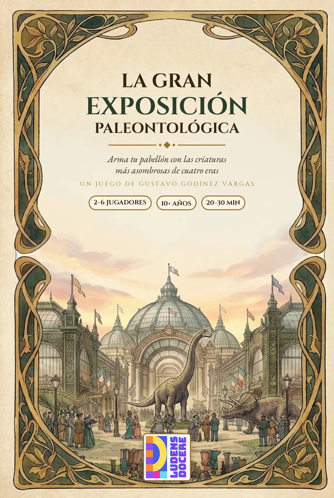

# La Gran Exposición Paleontológica

Un juego de Gustavo Godínez Vargas · Ludens Docere.

Sitio web del juego de cartas de Ludens Docere: presentación, cómo se juega, museo ilustrado con las 60 especies, Gabinete de Rarezas y descargas print & play.

Sitio estático (HTML + CSS + JS, sin compilación). Los datos de las fichas están en `data.json`.
